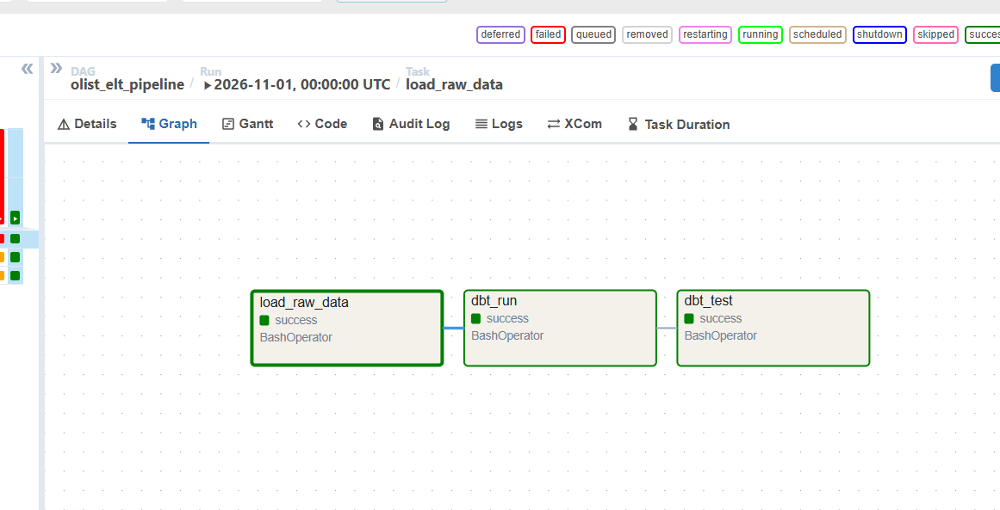
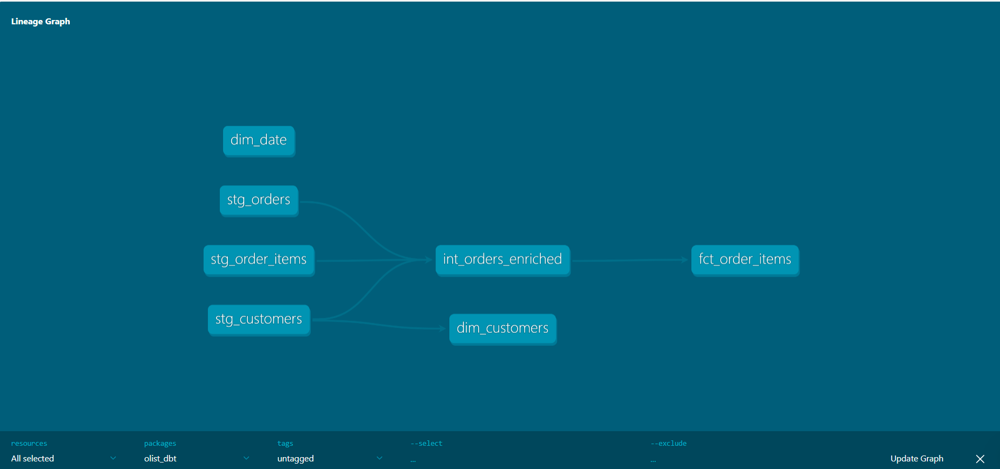
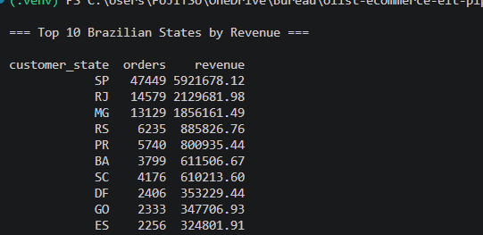

# Olist E-commerce ELT Pipeline (Local Modern Data Stack)

## 📌 Project Overview
> End-to-end ELT pipeline processing 100k+ e-commerce orders — built locally with open-source tools, zero cloud costs.

This project demonstrates production-grade data engineering practices: object storage (S3-compatible), workflow orchestration, modular SQL transformations, automated data quality tests, dimensional modeling (star schema), and full reproducibility with Docker.

## 🏗️ Architecture
The pipeline follows the **Lakehouse pattern**: raw files are stored in MinIO (S3-compatible object storage), loaded into DuckDB, transformed with dbt, and modeled into a star schema for analytics.

[CSV Files] → [MinIO (S3)] → [Airflow] → [DuckDB (Raw)] → [dbt (Staging → Marts)] → [DuckDB (Analytics)]

## 🛠️ Tech Stack
- **Object Storage:** MinIO (S3-compatible Data Lake)
- **Orchestration:** Apache Airflow
- **Data Warehouse:** DuckDB (Serverless, in-process OLAP)
- **Transformation:** dbt Core (dbt-duckdb)
- **Data Quality:** dbt tests (unique, not_null, accepted_values, relationships)
- **Containerization:** Docker Compose
- **Language:** Python, SQL

## 📂 Dataset
[Brazilian E-Commerce Public Dataset by Olist](https://www.kaggle.com/datasets/olistbr/brazilian-ecommerce) — 9 CSV files covering orders, customers, products, sellers, payments, and reviews (2016–2018).

This project uses 3 core files:

- `olist_orders_dataset.csv`
- `olist_customers_dataset.csv`
- `olist_order_items_dataset.csv`

## 🗄️ Storage Layer (MinIO)

Raw CSV files are uploaded to a **MinIO** bucket before being loaded into DuckDB. This simulates a production Data Lake where storage is decoupled from compute.

DuckDB reads the files directly from MinIO using the `httpfs` extension, configured as an S3-compatible endpoint.

---

## 🏗️ Data Architecture (Medallion)

| Layer | Schema | Materialization | Purpose |
|---|---|---|---|
| **Raw** | `raw.*` | Tables | CSV files loaded as-is from MinIO |
| **Staging** | `main_staging.stg_*` | Views | Cleaned, renamed, type-cast |
| **Intermediate** | `main_intermediate.int_*` | Views | Joined datasets ready for aggregation |
| **Marts** | `main_marts.*` | Tables | Star schema for analytics |

### Star Schema

- **`fct_order_items`**: Grain = one row per order item. Measures: `price`, `freight_value`, `total_item_value`.
- **`dim_customers`**: Customer attributes (city, state).
- **`dim_date`**: Date spine from 2016-09-01 to 2018-12-31.

---

## ✅ Data Quality

Every model is tested with dbt:

- `unique` and `not_null` on primary keys
- `accepted_values` on categorical columns (e.g., `order_status`)
- `relationships` between fact and dimension tables (referential integrity)

## 🚀 Key Features
- **Lakehouse Pattern:** MinIO (storage) decoupled from DuckDB (compute).
- **Medallion Architecture:** Bronze (raw) → Silver (cleaned) → Gold (star schema).
- **Star Schema:** `fct_order_items`, `dim_customers`, `dim_date`.
- **Automated Testing:** 15+ dbt schema tests ensure data integrity.
- **Reproducible:** Runs entirely on a local machine with `docker-compose up`.

## 📊 Sample Output

